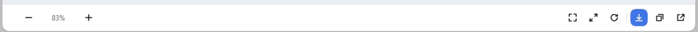

# dsh-image-viewer-pro

A usable image viewer for DeepSeek Harness.

The stock preview only offers a close button. This plugin takes over every content image the chat renders (Markdown images, attachments, `read_image` results) and opens a dialog with zoom, pan, rotate, download, copy and gallery browsing.




## Features

- **Zoom** — wheel zooms around the pointer; the footer shows `− [percent] +`, and the percentage is editable (Enter applies, Esc reverts). Press and hold ± to keep zooming.
- **Pan** — drag the image; double-click toggles fit ↔ actual size.
- **Rotate** — 90° per click.
- **Download original** — with progress; saves to the system downloads folder.
- **Copy image** — writes a PNG to the clipboard.
- **Gallery** — browse the other images in the same session with the round side arrows or `←` / `→`; shows `current / total`.
- **Open with default app** — local images open in their OS application; remote `http(s)` images open in the default browser.
- **Native look** — the mask uses DSH theme tokens, the dialog follows light/dark, and the host window buttons stay uncovered.

## Shortcuts

| Key | Action |
| --- | --- |
| `Esc` | Close (leaves the percentage field first) |
| `+` / `=` | Zoom in |
| `-` | Zoom out |
| `0` | Fit to window |
| `1` | Actual size (1:1) |
| `R` | Rotate 90° |
| `←` / `→` | Previous / next image |
| Double-click | Fit ↔ actual size |

## Install

### DSH plugin page

1. Open **Plugins → Add plugin**
2. Paste:

```text
github:NingYuanLee/dsh-image-viewer-pro
```

3. Refresh or restart DSH when prompted.

### CLI

```sh
dsh plugin --profile desktop add github:NingYuanLee/dsh-image-viewer-pro
```

> A desktop profile change is applied on the next DSH start.

## Uninstall

```sh
dsh plugin --profile desktop remove dsh-image-viewer-pro
```

Uninstalling restores the stock preview and never deletes sessions or images.

## Compatibility

- Verified on DSH `0.2.1-rc.2` (Web GUI and desktop).
- Implemented as a **capture-phase `` click interceptor plus a plain DOM overlay**, so it does not depend on the official slot contracts.
- Uses the `remote` / `remote.session` services for "open with default app"; when unavailable the action degrades to a notice.

## Conformance with DSH plugin conventions

Checked against the official *Packaging and installing plugins* / *Adding a workspace package* docs and the awesome-dsh-plugin listing requirements:

| Requirement | Status |
| --- | --- |
| `package.json` declares `dsh.bundle` (installable via `dsh plugin add`) | ✅ `dsh.bundle.patch` |
| Root `cordis.patch.yml` whose row name matches the package | ✅ `name: dsh-image-viewer-pro` |
| Supported DSH version range | ✅ `engines.dsh: >=0.2.1-rc.2 <0.3.0` |
| Presentation metadata (title / description / icon) | ✅ `locale/{zh,en}.json` + `icon.svg`, exporting `./package.json` and `./locale/*.json` |
| Installable without a build step (no `prepare`, no `allowBuilds` for git installs) | ✅ plain JS, verified with `dsh plugin add github:...` |
| Web styling rules (semantic tokens, no border+elevation pairing, `corner-shape` on circles, reduced motion) | ✅ see the `CSS` constant in `client.js` |
| Real working code | ✅ smoke tests + live verification |

## Development

```sh
git clone https://github.com/NingYuanLee/dsh-image-viewer-pro.git
cd dsh-image-viewer-pro
npm test
```

For local development, install the directory into a profile as a `link:` dependency; a page refresh reloads the client half (the first registration needs one restart).

| File | Role |
| --- | --- |
| `client.js` | Everything browser-side: icons, dialog, gestures, download, copy |
| `index.js` | Host placeholder so the package is a Loader-scannable bundle |
| `cordis.patch.yml` | Inserts the Loader row into the profile |
| `test/smoke.test.cjs` | Pure-function smoke tests (zoom bounds, fit ratio, file names, inject declaration) |

## Privacy

- No third-party requests, no access to model credentials.
- Download / copy only touch the current image; "open with default app" goes through DSH's Host-side capability.

## Known limitations

- Icons are inline 16px SVG; the `1:1` digits are dense at that size.
- Targets the DSH Web GUI and desktop client (same Web renderer).

## License

MIT © 2026 [NingYuanLee](https://github.com/NingYuanLee)
