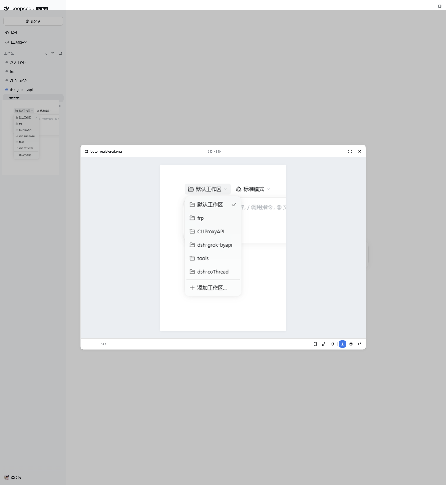

# dsh-image-viewer-pro

[](LICENSE)
[](https://github.com/deepseek-ai/deepseek-harness)
[](https://github.com/NingYuanLee/dsh-image-viewer-pro/releases)

**A viewer for images inside a DeepSeek Harness conversation — not a close button with a picture behind it.** Zoom, pan, rotate, a gallery, download, copy, a dialog you can drag, and open-with the apps already on the machine, in one layer. Wheel, drag, and rotate update on the compositor once per frame; the next image is decoded before it is shown, so a page turn does not flash at the wrong size. It replaces the stock preview that only offers Close.

English | [中文](README.zh.md)



## Why

The stock image preview in DSH 0.2.1-rc.2 only offers **Close**: no zoom, no pan, no rotate, no download, no switching between the images of one conversation. This plugin takes over content-image clicks in the **capture phase** and renders its own dialog — it does not depend on official slot contracts, so it stays working when image slots change.

The viewer improves *looking*; it cannot make an image appear. See [Getting images into the conversation](#getting-images-into-the-conversation) for prompt rules that get an agent to inline images in the first place.

## Features

- **Zoom** — wheel zooms around the pointer. One mouse notch is about 12% and eases in over a few frames; trackpad ticks stay continuous. The footer shows `− [percent] +` and the percentage is editable (Enter applies, Esc reverts). A tap on ± matches one notch; holding ± zooms continuously (about one doubling every 0.7s). Keyboard `+` / `-` stays a 25% step. The scale stays within 5%–4000%.
- **Pan** — drag the canvas; double-click toggles fit ↔ actual size.
- **Footer** — the controls sit in three groups separated by hairlines: zoom, fit / 1:1, and rotate.
- **Move the dialog** — drag its title bar; the dialog stays inside the backdrop (never over the desktop's native title/menu bar) and is pulled back into bounds when the window is resized.
- **Header info** — the title row shows `width × height | format | file size` with values only; the format is uppercase (JPG/PNG/SVG/BMP/WEBP…) and the size switches between B, KB and MB (one decimal for KB/MB).
- **Rotate** — counterclockwise on the left, clockwise on the right, 90° per click, with the current angle centered between them.
- **Download original** — with progress; saves to the system downloads folder.
- **Copy image** — writes a PNG to the clipboard.
- **Gallery** — browse the other images in the same conversation with the round side arrows or `←` / `→`; shows `current / total`.
- **Open** — a local file uses a split button. The main face shows the default app's icon and opens the file with that app; the menu lists every associated app reported by `session.workspacePathApplications` (the default is marked) and ends with "Show file location". A remote `http(s)` image stays a new-tab button. `blob:` and `data:` sources hide it. Opening and revealing both go through the Host's `session.openWorkspacePath`.
- **Native look** — the backdrop covers the window content area (the app's own top toolbar included) but stops below the desktop frame's native title/menu bar on Windows (`--dsh-frame-chrome-top`), and the dialog moves only inside that area; both use DSH theme tokens, follow light/dark, and honour `prefers-reduced-motion`.

## What it takes over

| Image | Viewer |
| --- | --- |
| Markdown images in message text (``, http(s) or the Host file route) | ✅ |
| Images attached to user and assistant messages (DSH renders them as `blob:` URLs) | ✅ |
| Tool-result images such as `read_image` (same attachment channel) | ✅ |
| Icons, avatars and status images below 48px | ❌ stay native |
| Images inside the plugin's own dialog (recursion guard) | ❌ |

Only the click behaviour is intercepted: message content is not modified, no session data is written, and the page returns to normal after closing the dialog.

## Getting images into the conversation

The viewer only improves *looking*. Whether an image appears at all is decided by what the agent emits: DSH renders Markdown images from the reply and image attachments from tool results, and this plugin takes over the click afterwards. Most agents summarise UI work in text ("the layout looks correct") and never inline a single picture — which is why the feature is easy to overlook.

Add the rules below to your global `AGENTS.md`, a project `AGENTS.md`, or the custom-instructions field. They are deliberately imperative: "inline every image" steers a model far more reliably than "you may attach screenshots".

**Images always inline**

```markdown
## Images

- Any image you produce, find, or refer to (including screenshots) must be shown inline: ``.
- Show it without being asked. Never reply with only a file path or only a `present` file card — the image is part of the reply.
- Use an absolute path with forward slashes and wrap the destination in angle brackets. A relative path only resolves when the viewed session has a workspace root; otherwise it renders as a broken image.
- Download remote images into the workspace first, then inline the local file.
- Inline images only. Code, documents and spreadsheets follow the delivery rules of their own tools.
```

**UI verification ends with a screenshot**

```markdown
## UI verification and screenshots

- Verify UI and interaction questions in a real session: open → snapshot/screenshot → operate → check Console/Network. Do not substitute reading source code or reasoning for verification.
- At the end of the verification, inline the key screenshots in the reply and state which step each one shows. Do not paste only paths.
- Save screenshots into the workspace and inline them with ``.
- Write local origins (`127.0.0.1`, `localhost`, any port) as inline code, never as clickable links, and note "open it in your system browser".
```

Why these constraints:

- DSH serves inline local images through an authenticated file route (`GET /api/file?path=<absolute path>`, mounted by its session media references). It accepts POSIX absolute paths and Windows drive-letter paths; DSH's own docs note that this route needs an HTTP(S) page, so desktop `dsh-app:` pages do not support it.
- Relative chat image paths only resolve when the viewed session has a workspace root, so absolute paths are the portable choice.
- Tool-result images (`read_image`, browser screenshots) already arrive as rendered attachments and are picked up as-is; the agent should still caption them instead of letting the picture speak for itself.

A quick way to test the whole chain: ask "screenshot it and inline it" for a page you can see. If the reply shows an image, click it — the viewer opens. If no image appears, check in order: Markdown syntax versus a bare path, an absolute path with forward slashes, and whether the file actually exists.

## Shortcuts

| Key | Action |
| --- | --- |
| `Esc` | Close (leaves the percentage field first) |
| `+` / `=` | Zoom in |
| `-` | Zoom out |
| `0` | Fit to window |
| `1` | Actual size (1:1) |
| `R` | Rotate 90° clockwise |
| `Shift`+`R` | Rotate 90° counterclockwise |
| `←` / `→` | Previous / next image |
| Double-click | Fit ↔ actual size |

## Install

This is a plain-JavaScript DSH bundle (`package.json` declares `dsh.bundle`): nothing to build, no build-script approval, and a page refresh is enough (restart DSH once after the first install).

### DSH plugin page

1. Open **Plugins → Add plugin**
2. Paste:

```text
github:NingYuanLee/dsh-image-viewer-pro
```

3. Refresh or restart DSH when prompted.

### CLI

Web profile (the one `dsh web` boots):

```sh
dsh plugin --profile web add github:NingYuanLee/dsh-image-viewer-pro
```

Desktop profile:

```sh
dsh plugin --profile desktop add github:NingYuanLee/dsh-image-viewer-pro
```

> Use whatever profile you actually boot. A GitHub source install pulls the repository; this package has no `prepare` script, so pnpm never asks for `allowBuilds`.

### Prebuilt Release tarball

```sh
dsh plugin --profile web add https://github.com/NingYuanLee/dsh-image-viewer-pro/releases/latest/download/dsh-image-viewer-pro.tgz
```

## Uninstall

```sh
dsh plugin --profile web remove dsh-image-viewer-pro
```

Or disable / remove it from the Plugins page. Uninstalling restores the stock preview and never deletes sessions or images.

## Compatibility

- Verified on **DSH `0.2.1-rc.2`** (Web GUI and desktop, both Web renderers).
- Declares `engines.dsh: >=0.2.1-rc.2 <0.3.0-0` and `engines.node: >=22.19.0`, checked on install and profile boot.
- Uses the Host `remote` / `remote.session` services to open or reveal a local file. When those services are unavailable the action degrades to a notice and everything else keeps working.

## Conformance with DSH plugin conventions

Checked against the official *Packaging and installing plugins* docs and the awesome-dsh-plugin listing requirements:

| Requirement | Status |
| --- | --- |
| `package.json` declares `dsh.bundle` (installable via `dsh plugin add`) | ✅ `dsh.bundle.patch` |
| `package.json` declares `dsh.manifestVersion: 1` | ✅ `dsh.manifestVersion: 1` |
| Root `cordis.patch.yml` whose row name matches the package | ✅ `name: dsh-image-viewer-pro` |
| Supported DSH version range | ✅ `engines.dsh: >=0.2.1-rc.2 <0.3.0-0` |
| Supported Node version | ✅ `engines.node: >=22.19.0` |
| Official `@deepseek-ai/*` packages as `peerDependencies` | ✅ imports none, so no peers required |
| Presentation metadata (title / description / icon) | ✅ `locale/{zh,en}.json` + `icon.svg` |
| Installable without a build step | ✅ plain JS, verified with `dsh plugin add github:...` |
| Storefront screenshots | ✅ root `screenshots.json` |
| Repository topic `dsh-plugin` | ✅ |
| Real working code + tests | ✅ `npm test` (offline smoke + manifest consistency) and GitHub Actions |
| Web styling rules (semantic tokens, no border+elevation pairing, `corner-shape` on circles, reduced motion) | ✅ see the `CSS` constant in `client.js` |

## Development

```sh
git clone https://github.com/NingYuanLee/dsh-image-viewer-pro.git
cd dsh-image-viewer-pro
npm test
```

For local development, install the directory into a profile as a `link:` dependency; a page refresh reloads the client half (the first registration needs one restart).

| File | Role |
| --- | --- |
| `client.js` | Everything browser-side: icons, dialog, gestures, download, copy, gallery |
| `index.js` | Host placeholder so the package is a Loader-scannable bundle |
| `cordis.patch.yml` | Inserts the Loader row into the profile |
| `test/smoke.test.cjs` | Offline smoke tests plus manifest / registration-id / copy consistency checks |
| `screenshots.json` | Storefront screenshot list (1–8 relative paths) |

## Privacy

- No third-party requests, no access to model credentials.
- Download / copy only touch the current image. Opening or revealing a local file goes through DSH's Host-side capability.
- Interception only affects clicks: no message content is injected and no session record is modified.

## Known limitations

- Icons, avatars and status images below 48px stay native (see the coverage table above).
- Remote cross-origin images are displayed by the browser directly; when their server does not allow CORS, download falls back to opening the image in a new tab and copy falls back to copying its URL.
- Icons are inline 16px SVG; the `1:1` glyph is dense at that size.
- Targets the DSH Web GUI and desktop client (same Web renderer).
- The gallery counts images currently rendered in the conversation scrollport; in extreme virtual-scrolling cases only mounted images can be browsed.

## License

MIT © 2026 [NingYuanLee](https://github.com/NingYuanLee)
