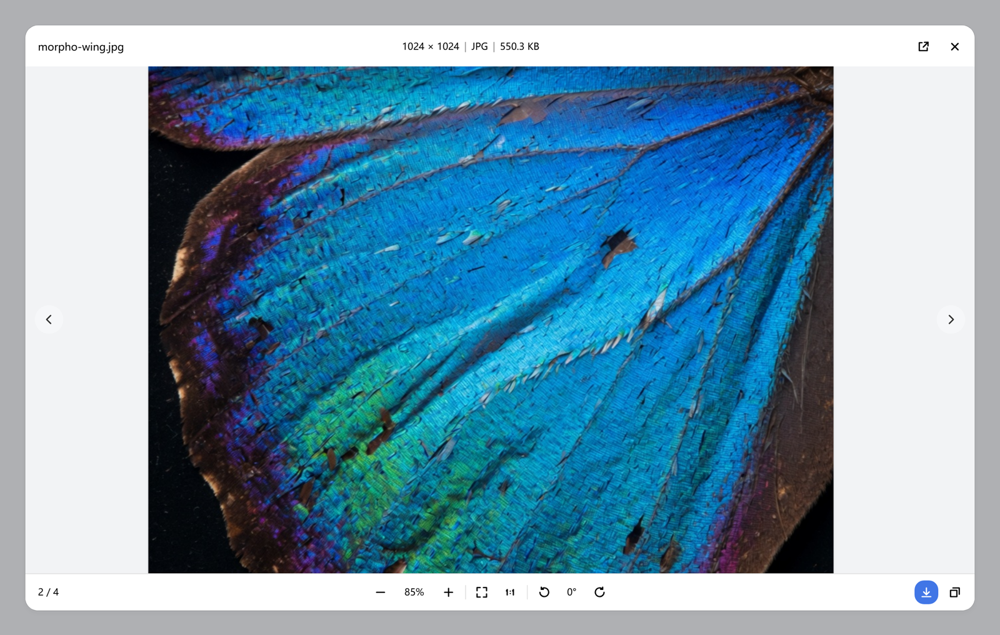
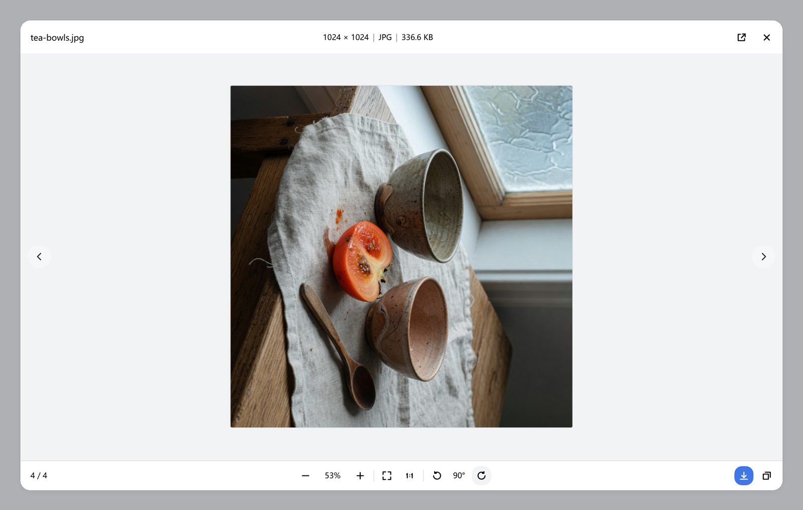
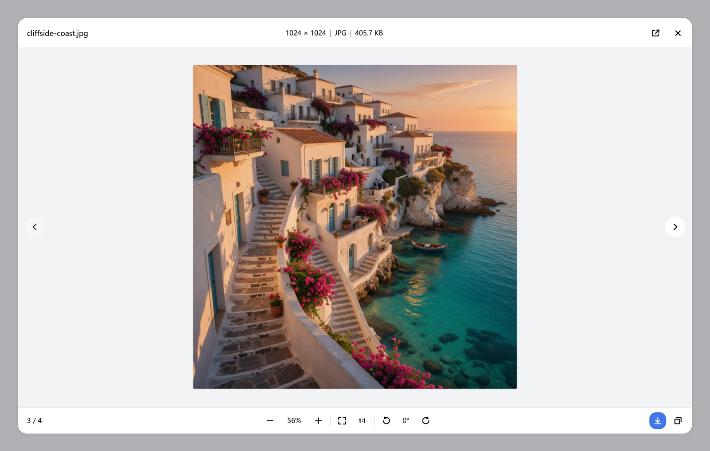
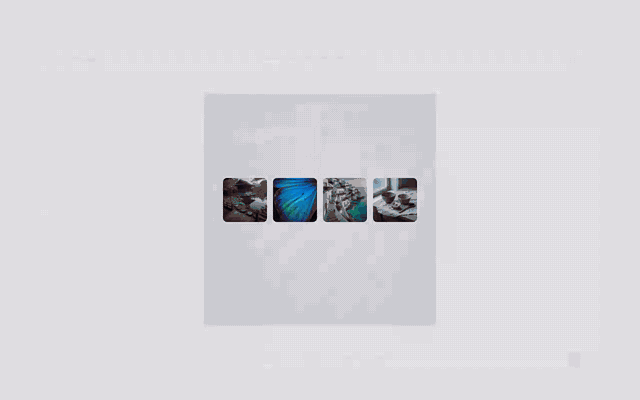
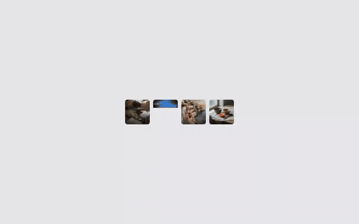
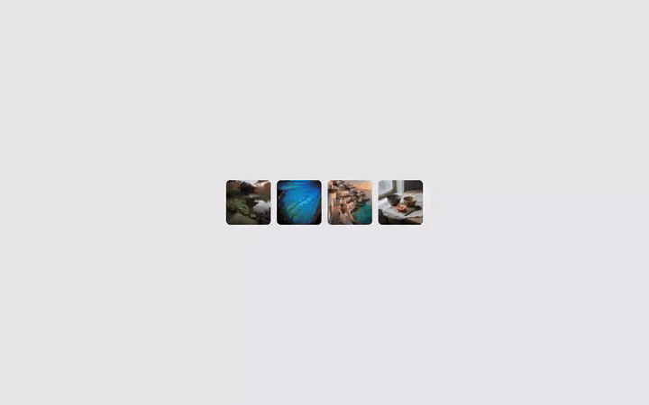
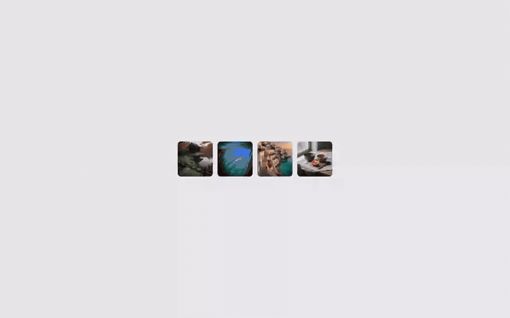
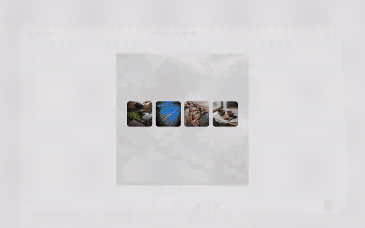

# dsh-image-viewer-pro

[](LICENSE)
[](https://github.com/deepseek-ai/deepseek-harness)
[](https://github.com/NingYuanLee/dsh-image-viewer-pro/releases)

**聊天里的图片，按查看器来用，而不是一张图加一个关闭按钮。** 缩放、平移、旋转、图集、下载、复制、拖动窗口，以及用这台电脑上已有的应用打开，都在同一个弹层里。滚轮、拖动和旋转每帧只更新合成层；下一张先解码再换上，避免切图时先闪到错误比例。它替换官方只有「关闭」的预览。

[English](README.md) | 中文


## 看一看

下面是真实查看器的截图和操作录像，样片是为这一页生成的。GitHub 上 GIF 会直接播放，MP4 链接是同一段录像。

<p>



</p>

**缩放和平移。** 滚轮以指针为中心放大，拖动画布移动画面。



[zoom.mp4](docs/zoom.mp4)

**旋转。** 每点一次转 90°，底栏显示当前角度。



[rotate.mp4](docs/rotate.mp4)

**图集。** 两侧圆按钮或 `←` / `→` 在同一会话的图片之间切换，新图从那一侧滑入。



[gallery.mp4](docs/gallery.mp4)

**拖动窗口。** 按住标题栏拖动，弹窗停在遮罩里面。



[move.mp4](docs/move.mp4)

**复制和下载。** 复制会写入 PNG 并弹出提示；下载保存原图。



[actions.mp4](docs/actions.mp4)

## 为什么装它

DSH 0.2.1-rc.2 的图片预览只提供「关闭」：看不清小字、不能放大、不能平移、不能下载、不能旋转，也无法在同一个会话的多张图之间切换。本插件在**捕获阶段接管内容图片的点击**，用自绘弹层替换它 —— 不依赖官方 slot 契约，因此对官方图片位的调整不敏感。

查看器只改善「看得清」，并不能让图片出现。怎么让智能体主动内联图片，见[让智能体真的发图：提示词建议](#让智能体真的发图提示词建议)。

## 功能

- **缩放**：滚轮以指针为中心缩放。鼠标滚轮一格约 12%，并在几帧内滑到目标；触控板小步进当帧生效。底部 `− [百分比] +`，百分比可直接输入（回车生效，Esc 取消）。点按 ± 与滚轮一格相同；按住 ± 连续缩放（大约 0.7 秒放大一倍）。键盘 `+` / `-` 仍是 25%。倍率限制在 5%–4000%。
- **平移**：拖动画布平移；双击在「适应窗口 / 原始大小」之间切换。
- **底栏**：控件分成三组，组间用竖线隔开：缩放、适应窗口 / 1:1、旋转。
- **拖动窗口**：按住弹窗标题栏拖动，位置限制在遮罩范围内（桌面端不进入原生标题栏/菜单栏区域）；窗口缩放时已拖动的弹窗自动收回边界内。
- **顶栏信息**：标题行显示「宽 × 高 | 格式 | 文件大小」，只显示值；格式大写（JPG/PNG/SVG/BMP/WEBP…），大小按 B/KB/MB 自动换算（KB、MB 保留 1 位小数）。
- **旋转**：左侧逆时针、右侧顺时针，每次 90°，中间显示当前角度。
- **下载原图**：带进度提示，完成后保存到系统下载目录。
- **复制图片**：写入剪贴板（非 PNG 自动转 PNG）。
- **图集浏览**：同一会话里的多张图用左右圆形按钮或 `←` / `→` 切换，显示 `当前 / 总数`。新图从所点的一侧推入，旧图向另一侧离开，大约 420ms，和弹窗打开同一条曲线。连点时先把正在播放的切换落到终点，再播下一次。系统开启「减少动态效果」时仍立即换图。
- **打开**：本地图片是分体按钮。主按钮显示默认应用的图标，并用该应用打开；下拉列出 `session.workspacePathApplications` 返回的关联应用（默认项标注「默认」），底部是「显示文件位置」。远程 `http(s)` 仍是「新标签打开」。`blob:` 与 `data:` 不显示这个按钮。打开和显示位置都走 Host 的 `session.openWorkspacePath`。
- **原生观感**：遮罩覆盖窗口内容区（含应用自己的顶部工具条），但桌面端会避开原生标题栏/菜单栏（Windows 下按 `--dsh-frame-chrome-top` 起始），原生菜单栏不会被压暗；弹窗只在遮罩内拖动；遮罩与弹层使用 DSH 主题令牌，跟随亮/暗主题；支持 `prefers-reduced-motion`。

## 覆盖范围

| 图片 | 是否接管 |
| --- | --- |
| 聊天正文的 Markdown 图（``，http(s) / 本站文件路由） | ✅ |
| 用户与助手消息里的附件图（DSH 以 `blob:` URL 渲染） | ✅ |
| `read_image` 等工具结果里的图片缩略图/大图（同样经附件通道） | ✅ |
| 小于 48px 的图标、头像、状态图 | ❌ 保持原生 |
| 插件弹层自身的图片（防递归） | ❌ |

接管只作用于点击行为：不修改消息内容、不写会话数据，关闭弹层后页面恢复原样。

## 让智能体真的发图：提示词建议

查看器只负责「看得清」；图片能不能出现，取决于智能体写了什么：DSH 会渲染回复正文里的 Markdown 图和工具结果里的图片附件，本插件只是在之后接管点击。大多数智能体把界面验证写成一句结论（「布局正常」），从不内联截图，所以这个功能很容易被忽略。

把下面的规则加进全局 `AGENTS.md`、项目的 `AGENTS.md` 或自定义指令里。措辞要下命令式：「一律内联」比「你可以附上截图」有效得多。

**图片一律内联**

```markdown
## 图片

- 你产生、找到或提到的图片（包括截图）一律内联：``。
- 不等用户开口就给图。不要只回一个路径，也不要只放 `present` 文件卡片——图片是回复的一部分。
- 用绝对路径、正斜杠，并用尖括号包住目标地址。相对路径只有当前查看的会话有 workspace root 时才解析得动，否则显示为裂图。
- 网络图片先下载到工作区，再内联本地文件。
- 只有图片这样内联；代码、文档、表格按各自工具的交付规则处理。
```

**界面验证以截图收尾**

```markdown
## 界面验证与截图

- 界面/交互问题要实机验证：打开 → 快照/截图 → 操作 → 查 Console/Network；禁止用读代码或口头推断代替验证。
- 验证结束把关键截图内联到回复里，并说明每张图对应哪一步；不要只贴路径。
- 截图落盘到工作区，用 `` 内联。
- 本机 origin（`127.0.0.1`、`localhost`，含任意端口）写成行内代码，不要发可点击链接，并注明「请用系统浏览器打开」。
```

为什么要卡这几条：

- DSH 通过鉴权文件路由（`GET /api/file?path=<绝对路径>`，由会话媒体引用挂载）提供正文里的本地图片，接受 POSIX 绝对路径与 Windows 盘符路径；官方文档同时说明这条路由需要 HTTP(S) 页面，桌面端 `dsh-app:` 页面不支持。
- 相对聊天图片路径要求当前查看的会话有 workspace root，因此绝对路径才是可移植写法。
- `read_image`、浏览器截图等工具结果里的图片本身就以附件渲染，插件同样接管；但智能体仍应配一句说明，别让用户自己猜图里是什么。

想验证整条链路：对着一个能打开的页面说「截个图并内联出来」。回复里出现图片就点它——弹层打开即为插件生效。没有图时依次检查：是否用了 Markdown 语法而不是裸路径、是否绝对路径加正斜杠、文件是否真实存在。

## 快捷键

| 按键 | 作用 |
| --- | --- |
| `Esc` | 关闭（输入框聚焦时先退出输入） |
| `+` / `=` | 放大 |
| `-` | 缩小 |
| `0` | 适应窗口 |
| `1` | 原始大小（1:1） |
| `R` | 顺时针旋转 90° |
| `Shift`+`R` | 逆时针旋转 90° |
| `←` / `→` | 上一张 / 下一张 |
| 双击 | 适应窗口 ↔ 原始大小 |

## 安装

本插件是纯 JavaScript 的 DSH bundle（`package.json` 声明 `dsh.bundle`），**无需构建、无需授权构建脚本**，装完刷新页面即可（首次加载新插件建议重启一次 DSH）。

### 方式一：DSH 插件页

1. 打开 **插件 → 添加插件**
2. 填入包名或地址：

```text
github:NingYuanLee/dsh-image-viewer-pro
```

3. 按提示刷新或重启 DSH。

### 方式二：命令行

Web 端（`dsh web` 使用的 profile）：

```sh
dsh plugin --profile web add github:NingYuanLee/dsh-image-viewer-pro
```

桌面端：

```sh
dsh plugin --profile desktop add github:NingYuanLee/dsh-image-viewer-pro
```

> 把 `--profile` 换成你实际启动的 profile 名即可。GitHub 源安装拉取源码，本插件没有 `prepare` 脚本，因此不会触发 pnpm 的 `allowBuilds` 授权。

### 方式三：Release tarball

不想让包管理器拉源码时，可直接安装预打包产物：

```sh
dsh plugin --profile web add https://github.com/NingYuanLee/dsh-image-viewer-pro/releases/latest/download/dsh-image-viewer-pro.tgz
```

## 卸载

```sh
dsh plugin --profile web remove dsh-image-viewer-pro
```

或在插件页停用 / 移除。卸载后恢复 DSH 官方预览，不会删除任何会话或图片。

## 兼容性

- 已在 **DSH `0.2.1-rc.2`**（Web GUI / 桌面端，同为 Web 渲染层）实机验证。
- 声明 `engines.dsh: >=0.2.1-rc.2 <0.3.0-0` 与 `engines.node: >=22.19.0`，安装与启动时会校验。
- 依赖 Host 的 `remote` / `remote.session` 服务来打开本地文件或显示文件位置；服务不可用时该操作退化为提示，不影响其他功能。

## 与 DSH 插件规范的对齐

对照官方《打包与安装插件》文档与社区 awesome-dsh-plugin 收录要求自查：

| 要求 | 状态 |
| --- | --- |
| `package.json` 声明 `dsh.bundle`（可被 `dsh plugin add` 安装） | ✅ `dsh.bundle.patch` |
| `package.json` 声明 `dsh.manifestVersion: 1` | ✅ `dsh.manifestVersion: 1` |
| 仓库根提供 `cordis.patch.yml`，行名与包名一致 | ✅ `name: dsh-image-viewer-pro` |
| 声明支持的 DSH 版本 | ✅ `engines.dsh: >=0.2.1-rc.2 <0.3.0-0` |
| 声明支持的 Node 版本 | ✅ `engines.node: >=22.19.0` |
| 官方 `@deepseek-ai/*` 包用 `peerDependencies` 声明 | ✅ 不 import 任何官方包，无需 peer |
| 插件元信息（标题/描述/图标） | ✅ `locale/{zh,en}.json` + `icon.svg` |
| 无构建步骤即可安装 | ✅ 纯 JS，已实测 `dsh plugin add github:...` |
| 市场截图声明 | ✅ 根目录 `screenshots.json` |
| 仓库 topic `dsh-plugin` | ✅ |
| 真实可用代码 + 测试 | ✅ `npm test`（离线冒烟 + 清单一致性）、GitHub Actions |
| Web 样式规范（语义 token、elevation 与 border 不配对、正圆 `corner-shape`、减少动效） | ✅ 见 `client.js` 的 `CSS` 常量 |

## 开发

```sh
git clone https://github.com/NingYuanLee/dsh-image-viewer-pro.git
cd dsh-image-viewer-pro
npm test
```

本地联调：把本目录以 `link:` 依赖装进 profile，改完刷新页面即可（首次加载新插件需重启一次）。

| 文件 | 作用 |
| --- | --- |
| `client.js` | 浏览器侧全部逻辑（图标、弹层、手势、下载、复制、图集） |
| `index.js` | Host 侧占位入口，让包成为可被 Loader 扫描的 bundle |
| `cordis.patch.yml` | 向 profile 插入 Loader 条目 |
| `test/smoke.test.cjs` | 离线冒烟测试 + 清单/注册 id/文案一致性校验 |
| `screenshots.json` | 插件市场截图清单（1–8 张，相对路径） |

## 隐私

- 不发起任何第三方网络请求，不读取模型凭据。
- 下载 / 复制只操作当前图片；打开本地文件或显示文件位置通过 DSH Host 的本地能力完成。
- 接管只发生在点击事件上，不注入消息内容、不改会话记录。

## 已知限制

- 小于 48px 的图标、头像与状态图保持原生（见上方覆盖范围）。
- 远程跨域图片由浏览器直接显示；若对方服务端未开放 CORS，下载会改为在新标签打开，复制会退化为复制图片链接。
- 图标为 16px 内联 SVG，`1:1` 图标在小尺寸下略密。
- 仅适配 DSH Web GUI 与桌面端（同为 Web 渲染层）。
- 图集按当前会话滚动区里已渲染的图片统计；极端虚拟滚动场景下只能浏览已挂载的图片。

## License

MIT © 2026 [NingYuanLee](https://github.com/NingYuanLee)
